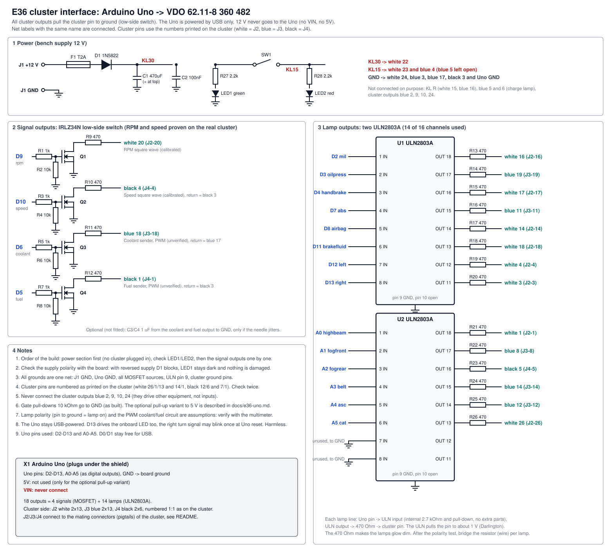

# Interface board: Arduino Uno to E36 cluster

Schematic, wiring list and parts list for the board between the Arduino Uno and the VDO 62.11-8 360 482 cluster
(no CAN). It is the hardware for [firmware-e36-uno](../firmware-e36-uno), the Uno pin plan is the one in
[docs/e36-uno.md](../docs/e36-uno.md).

| File | Content |
|---|---|
| [schematic.svg](schematic.svg) | The schematic (one sheet) |
| [wiring.csv](wiring.csv) | Every channel: Uno pin, driver, series resistor, cluster pin, board connector pin |
| [bom.csv](bom.csv) | Parts list with search terms for the shops |
| [make_schematic.py](make_schematic.py) | Generates all three files from one table. Change a pin there, run it again |

## What is in the design

18 outputs, every one pulls a cluster pin to ground (low-side switch), as already built and proven for RPM and speed.

| Group | Channels | Driver | Status |
|---|---|---|---|
| RPM, speed | D9, D10 | IRLZ34N, 1 k gate, 10 k pull-down, 470 Ohm series | **proven** on the real cluster |
| Coolant, fuel | D6, D5 | same circuit, PWM | **unverified**: the cluster's sender input is not characterised |
| 14 lamps | D2-D4, D7, D8, D11-D13, A0-A5 | 2 x ULN2803A, 470 Ohm series | **unverified**: lamp polarity is an assumption |
| Power | | 12 V screw terminal, T2A fuse, Schottky D1 against reverse polarity, KL15 toggle switch, two indicator LEDs | new |

Changes compared with the breadboard design in [docs/e36-uno.md](../docs/e36-uno.md):

- **Lamps use ULN2803A instead of 14 single transistors.** 2 chips instead of 14 transistors and 28 resistors, much less
  soldering, and the input resistor is inside. The price: the output pulls the pin to about 1 V, not to 0 V. That is fine
  for a lamp. It is **not** used for RPM and speed, because the calibration was done with the MOSFET and the cluster
  input threshold is not known.
- **Reverse-polarity protection and fuse** on the board, plus two LEDs so you can see 12 V and ignition without a multimeter.
- **KL15 switch** on the board instead of plugging wires.

## Before you build: things the schematic cannot settle

1. **Lamp polarity.** Assumed: the lamp lights when its pin is pulled to ground (the bulb sits between KL15 and the
   pin). Consistent with the pinout (white 23 / blue 4 supply the lamps, blue 3 is lamp ground), not measured.
2. **470 Ohm in the lamp lines** makes the bulbs glow dim (about 20 mA instead of 100 mA). It is there so a wrongly
   chosen pin cannot short anything. After a lamp has been proven, bridge its resistor with a wire. Do not bridge them all
   at once before testing.
3. **Coolant and fuel** go through PWM into a sender input. Unproven. Fit the optional 1 uF capacitors (C3/C4, to GND at
   the output) only if the needle jitters. Start with `set coolant_pwm=0` and small steps.
4. **Multimeter.** The backlog already lists it as mandatory. A 10 EUR meter is enough. Without it, use the LED
   procedure in [docs/e36-uno.md](../docs/e36-uno.md) section 4a, which is riskier.
5. **Mating connectors for the cluster are still open** (next section). Without them the board has nothing to plug into.

## Cluster connectors (open point)

The cluster has three plugs: white 26-pin, blue 26-pin, black 12-pin. The board brings them out as pin headers J2, J3,
J4 numbered **exactly like the cluster pins**, so a pigtail wire from header pin N goes to cluster pin N.

I did not find a confirmed part number for these mating connectors. What the search turned up, all **unverified**:

- A forum thread on E36 part numbers lists X13254 (26-pin, white) and X13255 (12-pin, natural)
  ([BMW-Syndikat](https://www.bmw-syndikat.de/bmwsyndikatforum/topic_p299045_teilenummern_zke_3er_BMW_-_E36.html)),
  without saying which one belongs to the cluster.
- An eBay listing offers a new original 26-pin housing, BMW 61136913626
  ([eBay](https://www.ebay.de/itm/174052386880)). Whether it fits this cluster is not stated.
- The same forum notes that the same part number can exist in several wiring variants, and that the plug codes differ.

Safest way: buy a **used E36 cluster plug set with pigtails** (scrapyard, eBay: "E36 Kombiinstrument Stecker Kabelbaum"),
hold it against the cluster and compare **pin count, colour and the numbers printed on the housing** before you pay.
Alternative: ask a BMW parts dealer with the chassis number, or look the plugs up in an ETK catalogue.

## Where to order

Prices and stock were **not checked** (the search tool did not index Reichelt; only ULN2803A was confirmed at
[TME](https://www.tme.eu/en/details/uln2803a/drivers-integrated-circuits/stmicroelectronics/),
[Bürklin](https://www.buerklin.com/en/p/50S2700) and
[Conrad](https://www.conrad.com/en/p/stmicroelectronics-transistor-bjt-arrays-uln2803a-dip-18-no-of-channels-8-npn-darlington-171824.html)).
Everything on the list is a standard through-hole part, so one distributor is enough:

| Shop | Why | How |
|---|---|---|
| Reichelt (DE) | all parts from one order, German search terms in `bom.csv` | paste the `search_term_shop` column |
| TME (PL, ships to DE) | cheap, confirmed ULN2803A | same |
| Conrad (DE) | fast, a bit pricier | same |
| Cluster plugs | not from an electronics shop | see the section above |

Order only after you have decided between a **perfboard/proto shield** (what the parts list assumes) and a printed PCB. The
BOM is the same either way except for the shield (X1).

Rough parts cost for everything except plugs and multimeter: about 20-30 EUR (my estimate, not a quote).

## Build order

1. Power section only (J1, F1, D1, C1, C2, SW1, LED1/2, R27/R28). Supply 12 V: LED1 on, flip SW1: LED2 on. Swap the
   supply wires: both stay dark and nothing is hurt.
2. Plug in the Uno, build Q1-Q4 and check on the bench (no cluster) as in [docs/e36-uno.md](../docs/e36-uno.md) section 4.
3. Plug in the cluster supply only (KL30, KL15, grounds) and see the lamp test.
4. Signals one by one: RPM, speed, then lamps, then coolant and fuel last.

## Not done yet

- The schematic is a drawing, **not a KiCad project**. A printed PCB needs it entered in KiCad first. Say so if you want that.
- No board layout and no enclosure.
- The channel table is generated from the repo, but the schematic has not been checked by a second person or built yet.
